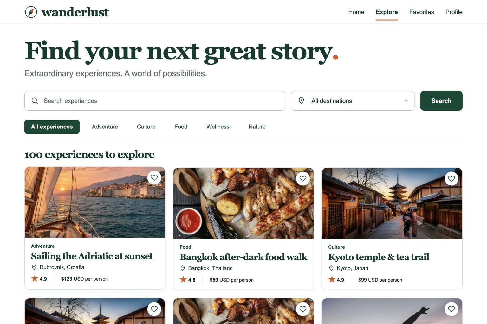
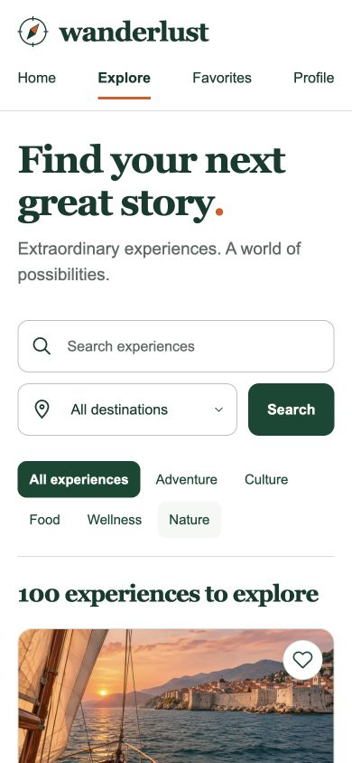

# Wanderlust Explorer

An interactive React + Next.js travel discovery app built for the 4Geeks AI Engineering assignment. Browse 100 AI-generated fictional experiences across 20 destinations, combine shareable filters, inspect details, and collect favorites.



## Run locally

Use Node.js 22.18+ (Node 24 recommended) and npm.

```sh
npm ci
npm run dev
```

Open [localhost:3000](http://localhost:3000). For the production app:

```sh
npm run build
npm start
```

The project was initialized with the official `create-next-app` CLI using TypeScript, Tailwind, ESLint, App Router, `src/`, and the `@/*` import alias. The npm scripts use Next's webpack option because this workstation restricts the local worker port used by Turbopack. Tailwind is processed through its official PostCSS adapter. No environment variables or backend services are required.

## Pages

| Route               | Purpose                                                                                 |
| ------------------- | --------------------------------------------------------------------------------------- |
| `/`                 | Photo-led home and Explorer call to action                                              |
| `/experiences`      | All 100 cards; title search, category tabs, destination filter                          |
| `/experiences/[id]` | Local dataset lookup, description, highlights, price, rating, duration, favorite toggle |
| `/favorites`        | Saved experiences and a helpful empty state                                             |
| `/profile`          | Mock traveler profile and live favorites count                                          |

Unknown experience IDs display a friendly not-found page. All internal navigation uses `next/link`; active navigation uses `usePathname`.

## Search and URL state

Try this link on your running app:

```text
/experiences?search=sailing&category=adventure&destination=Croatia
```

It pre-fills all three controls and shows **Sailing the Adriatic at sunset**. Title matching uses a case-insensitive `RegExp`. User text is escaped first so punctuation such as `[` or `.*` is safe literal search text rather than executable regex syntax. Category comparisons ignore case; destinations match either city or country. Conditions combine with AND, and all controls filter immediately. The Search button submits the live-search form without reloading.

`useFilters` reads `useSearchParams` and `usePathname`, updates the URL with Next-integrated `history.replaceState`, and delegates filtering to a pure function. It preserves unrelated query parameters. The URL is the source of truth, including when opening a bookmark. Clearing filters returns the Explorer to its base path. Every edit replaces the current history entry to avoid creating one entry per keystroke; browser Back/Forward still navigates between routes.

## Favorites and React hooks

`FavoritesProvider` owns `useState<string[]>` in the root layout, so favorites survive client-side page navigation. The custom `useFavorites` hook uses React's built-in context only to transport that root state across Next.js route boundaries. Pages pass `favoriteIds` and `onToggleFavorite` to `ExperienceGrid`, `ExperienceCard`, and `FavoriteButton` as typed props. Functional updates prevent stale toggle state. No Redux, Zustand, localStorage, or other state library is used. A full page refresh resets favorites, as required by the assignment scope.

`DetailContent` uses `useEffect` with `[experience.title]` to update the browser title. Reusable components include `Navbar`, `SearchBar`, `FilterBar`, `ExperienceCard`, and `ExperienceGrid`. `Experience` and `Category` are defined in `src/types/experience.ts`; the full 100-object array is in `src/data/experiences.ts`.

## Design References

Reviewed before implementation:

- [Airbnb Experiences](https://www.airbnb.com/experiences): discovery navigation, destination search, and experience-focused browsing informed the clear search hierarchy.
- [GetYourGuide](https://www.getyourguide.com/): destination-led discovery informed the location, price, and rating information on each card.
- [AllTrails](https://www.alltrails.com/): prominent search, outdoor imagery, and concise trail summaries informed the spacious experience cards.

The app uses an original evergreen, white, and orange design rather than reproducing any brand. The [generated visual concept](docs/design/explorer-concept.png), [design system](docs/design/design-system.md), and [visual review](docs/design/visual-review.md) document the implementation. Georgia headlines, labeled inputs, visible focus styles, a skip link, pressed heart states, live result counts, and reduced-motion support keep the interface readable and usable. Breakpoints provide three, two, and one card columns.

## Images and sample content

The Adriatic hero was generated with OpenAI Image Gen. Five locally bundled Unsplash photos are illustrative category placeholders, permitted by the assignment; they do not depict every destination or specific experience. The same category image is intentionally reused across demo items. Sources:

- [Adventure](https://images.unsplash.com/photo-1464822759023-fed622ff2c3b)
- [Culture](https://images.unsplash.com/photo-1493976040374-85c8e12f0c0e)
- [Food](https://images.unsplash.com/photo-1555939594-58d7cb561ad1)
- [Wellness](https://images.unsplash.com/photo-1544367567-0f2fcb009e0b)
- [Nature](https://images.unsplash.com/photo-1441974231531-c6227db76b6e)

All inventory, prices, ratings, and the Jordan Taylor profile are fictional. There is no booking flow. AI assistance was used for design, dataset generation, implementation, testing, and documentation, consistent with the assignment's coding-agent workflow.

## Verification

```sh
npm run lint
npm run typecheck
npm test
npm run build
```

Nine Node tests validate dataset completeness, unique IDs/titles, category coverage, case-insensitive search, city/country filtering, combined filters, unknown values, literal regex punctuation, and whitespace. The production build generates all 100 detail routes. [Verification evidence](docs/verification.md) records the manual browser workflow and responsive checks.



## Submission

Repository: [leelaamaj/nextjs-wanderlust-explorer](https://github.com/leelaamaj/nextjs-wanderlust-explorer). A deployment is optional in the brief; this project is delivered as a runnable repository.
